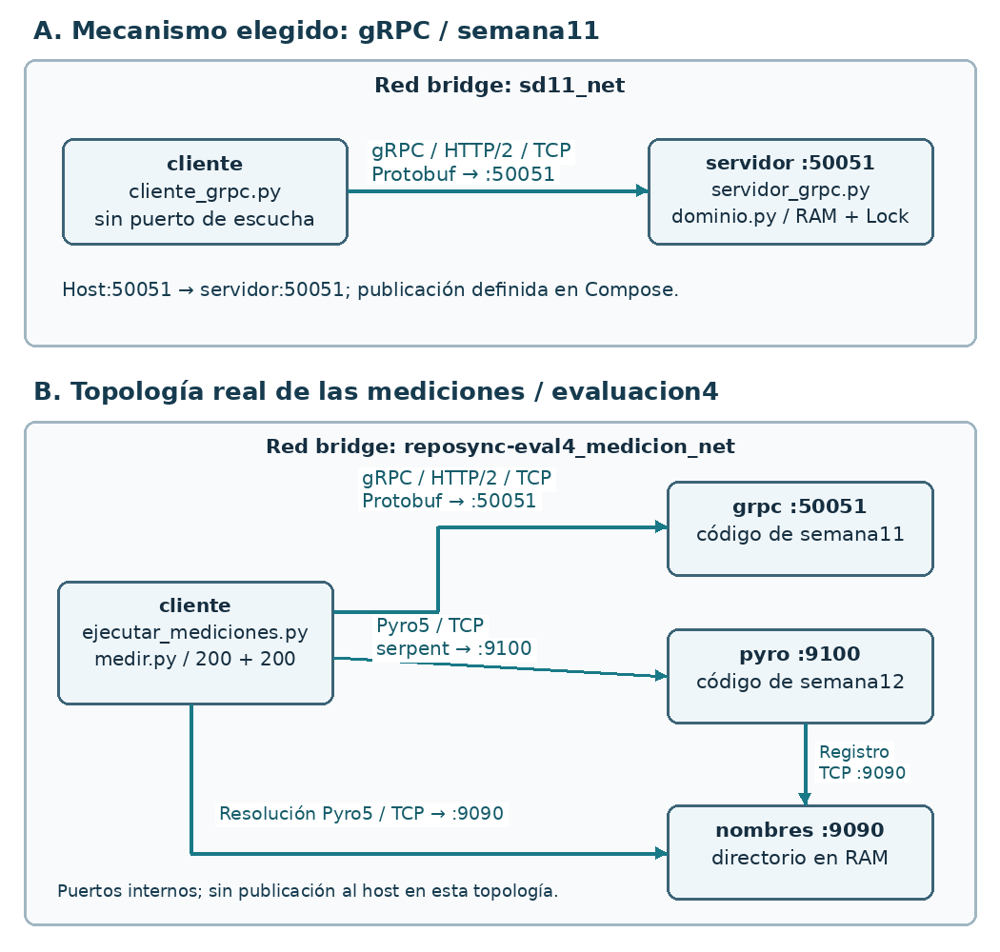

# Reporte de Servicios Cliente-Servidor

**Equipo:** Thomas Pinda  
**Integrantes:** Thomas Pinda  
**Dominio:** 04. Control de versiones distribuido (Git/GitHub)  
**Servicio:** RepoSync  
**Repositorio:** https://github.com/Pinda19/SistemasDistribuidos  
**Fecha:** 20-11-2026

> Informe con 9 páginas de desarrollo en PDF, más portada y referencias.

## 1. El servicio y su dominio

RepoSync aborda un problema de coordinación del trabajo de desarrollo: dos personas pueden preparar cambios desde la misma revisión de una rama y publicar en momentos distintos. El servidor mantiene el HEAD de cada rama; una publicación indica la base conocida por el cliente. Si esa base ya no coincide, el servicio rechaza el cambio para impedir que se acepte silenciosamente una publicación desactualizada.

El dominio asignado es el tema 04, control de versiones distribuido (Git/GitHub). El prototipo lo usan clientes de línea de comandos y un generador de carga. Cada cliente representa a un integrante que consulta una rama, propone una publicación o revisa el historial. Se trabaja con un repositorio inicial llamado proyecto y su rama main, con revisión 0.

| Operación | Responsabilidad y regla |
| --- | --- |
| Clonar / clonar | Consulta el HEAD de una rama; no descarga archivos ni modifica el dominio. |
| Rama / rama | Crea una referencia desde la rama origen; rechaza nombres duplicados o recursos inexistentes. |
| Push / push | Publica una revisión únicamente si base coincide con el HEAD vigente. |
| Historial / historial | Consulta las revisiones enlazadas por su padre, desde el HEAD hacia el inicio. |
| PublicarAuto / publicar_auto | Agrega una revisión sin base; operación no idempotente introducida en semana11 para estudiar reintentos. |
| abrir_cambio / CambioEnCurso | En semana12 representa autor, base y rutas mediante un objeto remoto temporal. |

### Estado e invariantes

El estado vive en memoria del proceso servidor. En semana11/dominio.py, un Lock protege tanto la comparación de base como el avance de HEAD y la asignación de una nueva revisión. Las ramas comparten la numeración de revisiones del repositorio, pero conservan referencias HEAD independientes. Reiniciar el proceso vuelve a crear el estado inicial y no recupera revisiones anteriores.

RepoSync es una simulación cliente-servidor de referencias y conflictos. No implementa los objetos, hashes, almacenamiento de archivos, merges ni clones completos de Git. En CambioEnCurso las rutas se incorporan como metadatos al mensaje de revisión. La necesidad central de este dominio es conservar la coherencia de las publicaciones y poder determinar su resultado frente a fallos.

Fuentes del repositorio: semana06/protocolo.md; semana11/dominio.py y contrato.md; semana12/objetos.py. Las descripciones de operaciones en etapas anteriores no implican que todas las etapas expongan el mismo conjunto: semana10 implementa rama y clonar.

<!-- salto de página en el PDF -->

## 2. Arquitectura y topología

La figura distingue el despliegue elegido para la presentación, definido en semana11/docker-compose.yml, de la topología utilizada para comparar los dos mecanismos. Las líneas indican destinos, puertos y protocolos; cada rectángulo de servicio representa un contenedor.



Figura 1. Despliegue de RepoSync. Fuente editable: img/despliegue.drawio. En A, cliente construye solicitudes y servidor aplica el dominio. En B, el contenedor cliente ejecuta las dos mediciones, grpc y pyro ejecutan copias del código real de las semanas 11 y 12, y nombres resuelve sd.pinda.repositorio.

Cada servidor mantiene su propia RAM: gRPC y Pyro5 no comparten revisiones durante el ensayo. Ambos parten con proyecto/main HEAD=0. El directorio solo interviene en el descubrimiento de Pyro5; el cliente invoca directamente el objeto una vez resuelto. Los resultados se escriben mediante un volumen en docs/informe/evidencias.

La topología B procede de evaluacion4/medicion/docker-compose.yml. Su red tiene el prefijo del proyecto Compose reposync-eval4 y no publica puertos al host. El volumen de resultados guarda evidencia, no persistencia de ramas. El servidor de A sí publica 50051:50051; su Lock y su caché son locales al proceso.

<!-- salto de página en el PDF -->

## 3. Evolución del contrato

La operación elegida en todas las etapas es consultar el HEAD de proyecto/main. La plantilla agrupa semanas 4 y 6 en una única etapa de protocolo de texto sobre TCP; para esa etapa se usa la implementación de RepoSync de semana6. Las etapas posteriores mantienen el propósito de consulta, cambiando la representación del contrato y su transporte.

| Etapa | Semana | Dónde está el contrato | Ejemplo de la misma consulta |
| --- | --- | --- | --- |
| Texto sobre TCP | 4 y 6 | semana06/protocolo.md; servidor.py | CLONAR proyecto main seguido de salto de línea. Respuesta: OK proyecto main HEAD=0. |
| REST | 7 | semana07/interfaz_http.md; api.py | GET /repos/proyecto/ramas/main. Respuesta JSON con repositorio, rama, head y replica. |
| Mensajes estructurados | 9 | semana09/protocolo.md; mensajes.py; codec.py | Solicitud(version=2, id=7, operacion="CLONAR", argumentos=["proyecto","main"]). JSON o binario con longitud de 4 bytes. |
| JSON-RPC | 10 | semana10/rpc.py | POST /rpc con {"jsonrpc":"2.0","id":7,"method":"clonar","params":{"repo":"proyecto","rama":"main"}}. |
| gRPC | 11 | semana11/proto/servicio.proto; contrato.md | RepoSyncStub.Clonar(ClonarSolicitud(repo="proyecto", rama="main")); devuelve EstadoRamaRespuesta. |
| Objetos remotos | 12 | semana12/objetos.py; servidor_pyro.py | Proxy resuelto por sd.pinda.repositorio; obj.clonar("proyecto","main"); devuelve diccionario. |

### Continuidad semántica

En todos los ejemplos, el repositorio es proyecto y la rama es main. Sobre el estado inicial se obtiene HEAD=0. La consulta permite al cliente conocer la base que enviaría en una publicación posterior; no descarga archivos ni replica el repositorio. Se conserva esta interpretación al comparar los mecanismos y al medirlos.

La respuesta cambia de texto a estructuras con nombres de campos; en REST se agrega la réplica que atendió la solicitud. Ese dato es instrumentación del adaptador HTTP y no altera la revisión consultada. En semana10 se exponen clonar y rama: no se atribuye a ese adaptador el conjunto completo de operaciones de semana11.

Antecedente verificable: semana04/protocolo.md conserva el laboratorio inicial de sockets con HOLA, ECO, CONTAR y ACUMULAR. La adaptación del dominio se implementó en semana6 dentro de la etapa TCP indicada por la pauta. Se conserva ese historial, sin cambiar el código original ni atribuirle operaciones que no tenía.

<!-- salto de página en el PDF -->

### 3.1. Qué se ganó y qué se perdió en cada cambio

| Transición | Ganancia para RepoSync | Costo o capacidad que se pierde |
| --- | --- | --- |
| Texto TCP | Mensajes legibles y flujo directo. CLONAR, PUSH y RAMA permiten probar bases y conflictos con una terminal. | Análisis de argumentos, límites de mensaje, errores y compatibilidad quedan a cargo del código propio. |
| TCP → REST | Recursos y códigos HTTP; dos réplicas API traducen hacia el mismo dominio. Un cliente puede consultar una rama mediante GET. | Más saltos y traducciones. Replicar las APIs no replica el estado: el servidor TCP sigue siendo un punto único de falla. |
| REST/texto → estructurados | Versión, ID y enmarcado explícito; dos codecs comparten el esquema de Solicitud y Respuesta. | Se pierde compatibilidad directa con APIs que hablaban por líneas; aumenta el mantenimiento de codecs y validaciones. |
| Estructurados → JSON-RPC | Formato convencional de method, params, result y error; se reutiliza una especificación en lugar de definir cada campo del protocolo [3]. | El prototipo de semana10 reduce su superficie a dos métodos. Los tipos y reglas se validan manualmente; no hay IDL obligatorio. |
| JSON-RPC → gRPC | Contrato .proto, tipos y stubs generados. Push declara base e ID; los estados separan conflictos, parámetros inválidos y fallas de transporte [2]. | Hay que generar y versionar stubs; el mensaje binario es menos fácil de inspeccionar. Un esquema tipado no agrega persistencia. |
| RPC → objetos Pyro5 | Métodos sobre Repositorio y CambioEnCurso con identidad remota; las ediciones temporales pueden mantenerse en el servidor [4]. | Aparecen dependencia de nombres y ciclo de vida explícito. Una referencia puede quedar colgante; el estado temporal muere con el proceso. |

### Cinco decisiones de protocolo aplicadas al dominio

En semana9, codec.py define el enmarcado mediante longitud; mensajes.py fija la versión y el ID, separa resultado de error y declara el esquema de datos. En JSON-RPC, HTTP y la especificación normalizan parte de esas decisiones, aunque el adaptador todavía valida parámetros. En gRPC, Protobuf y los stubs sustituyen el codec manual. En Pyro5, la infraestructura transporta métodos y referencias de objetos.

La comparación de HEAD no pertenece al transporte: permanece en las reglas del dominio. Por eso cambiar texto por Protobuf no corrige por sí solo un reintento duplicado ni una pérdida de RAM. Este criterio guía la elección del mecanismo y el análisis de fallos, además de su formato de mensaje.

Versiones diferentes no deben confundirse: el documento de semana9 se denomina protocolo v3, mientras que el campo version del mensaje vale 2. El paquete gRPC se denomina reposync.v1 y la numeración de campos del .proto se conserva para evolucionar el contrato.

<!-- salto de página en el PDF -->

## 4. Mecanismo elegido y justificación

Se elige gRPC para presentar el servicio cliente-servidor el 4 de diciembre. La decisión prioriza hacer explícitos los datos y los resultados de publicar una revisión: base como entero, identidad lógica de la solicitud, conflictos y tiempos de espera. No se basa en obtener la menor latencia en esta medición; Pyro5 fue más rápido en el ensayo de consulta.

Se toman los criterios del cuadro de semana10: contrato/IDL, transporte y formato, lenguajes, referencias y estado, manejo de errores y las cinco decisiones de protocolo. Se comparan dos alternativas implementadas en el repositorio: JSON-RPC y Pyro5.

| Criterio | gRPC elegido | JSON-RPC | Pyro5 |
| --- | --- | --- | --- |
| Contrato y tipos | ClonarSolicitud, PushSolicitud y base int64 en .proto; stubs generados. | method y params JSON; nombres y tipos comprobados manualmente. | Métodos Python expuestos; firma dinámica y excepciones registradas. |
| Errores del dominio | FAILED_PRECONDITION identifica conflicto; INVALID_ARGUMENT distingue entrada inválida. | Objeto error con code/message/data; semana10 solo expone rama y clonar. | ErrorDominio y ErrorParametros conservan su clase; desconocer una referencia es un fallo adicional. |
| Estado y referencias | Solicitudes con repo/rama/base e ID; sin exigir referencias temporales al cliente. | Sin referencias remotas en la especificación; estado propio en el servidor. | CambioEnCurso simplifica edición temporal, pero su URI se pierde al morir el proceso. |
| Interoperabilidad | Esquema independiente del lenguaje; aquí solo se probó Python. | JSON fácil de integrar desde diferentes entornos. | Mayor acoplamiento al modelo de objetos y al ecosistema Python utilizado. |
| Transporte y formato | HTTP/2 y Protobuf; payload de consulta medido: 16 bytes. | HTTP POST y JSON legible; no se midió latencia en esta entrega. | Pyro5/TCP y serpent; payload medido: 75 bytes. |
| Costo de operación | Mantener .proto, stubs y compatibilidad; persiste un único servidor. | Implementación pequeña y depuración directa; validación manual. | Daemon más directorio; re-registro y gestión explícita de objetos. |

Para RepoSync, un conflicto de publicación debe ser distinguible de una petición inválida y de un resultado desconocido por timeout. El contrato de semana11 hace visibles esas condiciones y permite demostrar reintentos con un ID estable. La deduplicación la implementa la aplicación: no es una garantía automática de gRPC.

JSON-RPC sería razonable para una integración sencilla centrada en consultar y crear ramas. Pyro5 resulta útil para el proyecto integrador orientado a objetos y para CambioEnCurso. Para el informe cliente-servidor se mantiene gRPC como elección; la evolución posterior del proyecto integrador conserva los requisitos de objetos, cola y coordinación de la asignatura.

<!-- salto de página en el PDF -->

## 5. Evidencia de funcionamiento y medición

### 5.1. Procedimiento y entorno

La ejecución recibida se inició el 20-11-2026 a las 15:41:43 UTC, equivalentes a 12:41:43 en Chile. entorno_docker.txt registra Windows/amd64 como cliente, Docker Desktop 4.99.0, Engine 29.9.3, Compose v5.7.0 y servidor Linux/amd64. El proceso de medición registró Python 3.12.16.

La ejecución del Compose de evaluacion4/medicion levantó la topología B. ejecutar_mediciones.py comprobó que ambos servidores respondían proyecto/main HEAD=0 y ejecutó medir.py del curso, adaptado al stub RepoSync y a los valores del dominio. El cliente y cada servidor fueron contenedores distintos, según el Compose utilizado.

```text
Pyro5 listo: sd.pinda.repositorio;
  {'repositorio': 'proyecto', 'rama': 'main', 'head': 0}
gRPC listo: grpc:50051; proyecto/main HEAD=0
MEDICIONES TERMINADAS
```

Se midió la misma consulta sin escrituras: clonar(proyecto, main). Para cada mecanismo hubo 200 llamadas cronometradas, diez de calentamiento y una previa para obtener el tamaño. El canal gRPC y el Proxy Pyro se reutilizaron. Se ejecutó primero gRPC y después Pyro5, con un solo cliente y ambos servidores activos. El descubrimiento inicial de Pyro5 quedó fuera de las 200 llamadas.

### 5.2. Resultados reales

| Mecanismo | Operación | n | p50 ms | p95 ms | Media ms | Máx. ms | Bytes |
| --- | --- | --- | --- | --- | --- | --- | --- |
| gRPC | clonar | 200 | 0,83 | 1,32 | 0,91 | 1,49 | 16 |
| Pyro5 | clonar | 200 | 0,41 | 0,60 | 0,43 | 2,52 | 75 |

Fuente: evidencias/medicion_terminal.txt y mediciones_grpc.csv / mediciones_pyro.csv. La copia de la corrida se conserva en evidencias/corridas/20261120T154143_417429Z/. Corresponden a la ejecución real en Docker del equipo.

medir.py calcula cada intervalo con perf_counter y los percentiles seleccionando un elemento de la lista ordenada mediante redondeo de p/100 × (n−1). El tamaño se obtiene con ByteSize en Protobuf y len(serpent.dumps(...)) en Pyro5; no representa el tráfico completo con cabeceras y transporte.

La evidencia de operaciones que modifican estado se conserva en semana11/observaciones.md y semana12/evidencias/docker_utf8.txt. Allí figuran creación de rama, publicaciones, conflicto de base y ciclo de vida de CambioEnCurso. La medición de esta sección solo evalúa la consulta y no reemplaza aquellas pruebas.

<!-- salto de página en el PDF -->

### 5.3. Interpretación y límites de la comparación

En esta corrida Pyro5 obtuvo una media de 0,43 ms y gRPC de 0,91 ms. La diferencia media fue 0,48 ms: Pyro5 empleó aproximadamente el 47,3 % del tiempo medio de gRPC, una reducción del 52,7 %. También tuvo menor p50 y p95. El máximo, en cambio, fue mayor con Pyro5: 2,52 ms frente a 1,49 ms. La muestra no permite afirmar que todos los tiempos de Pyro5 sean menores.

La respuesta Protobuf ocupó 16 bytes frente a 75 bytes en serpent: 59 bytes menos, una reducción aproximada del 78,7 % del payload serializado. Protobuf omite valores predeterminados como head=0; serpent representa claves y valores del diccionario. Esto explica la diferencia de representación, pero no demuestra una reducción idéntica de tráfico total o ancho de banda.

No se midió qué componente produjo los 0,48 ms de diferencia. Como hipótesis, influyen los distintos runtimes, el despacho de llamadas, HTTP/2, el enmarcado Pyro y la planificación de procesos de Docker Desktop. La serialización compacta de gRPC no obliga a que una consulta tan pequeña tenga menor latencia. Separar esas causas requeriría perfiles y ensayos adicionales, que no forman parte de estos resultados.

Para una consulta interactiva de HEAD en una red local, una diferencia media inferior a un milisegundo no justifica por sí sola elegir el mecanismo. Tampoco se puede extrapolar a grandes historiales, publicaciones concurrentes o redes entre ciudades. Se prioriza el contrato de publicación y su tratamiento de errores; el costo de generación de código se acepta como parte de la elección de gRPC.

| Condición del ensayo | Alcance de lo que permite concluir |
| --- | --- |
| Una corrida, 200 consultas por mecanismo | Comparación descriptiva de este equipo; no prueba estadística universal. |
| Orden fijo y un cliente secuencial | No mide escalabilidad ni separa efectos del orden de ejecución. |
| Respuesta mínima y HEAD constante | No caracteriza historiales grandes ni escrituras. |
| Ambos servidores activos | Sus estados son independientes; ambos comparten recursos del host. |
| Sin captura de tráfico ni muestras individuales | No se calculan tasas de transferencia, intervalos de confianza ni distribución completa. |

### Trazabilidad de la medición

El Dockerfile copia servidor_grpc.py, dominio.py y stubs de semana11; para Pyro5 copia objetos.py, servidor_pyro.py y dominio.py de semana12. El medidor consulta esos servicios reales a través de la red de contenedores. La ejecución se reproduce desde la raíz con el Compose de evaluacion4/medicion y el cliente ejecutar_mediciones.py, como indica README_EVALUACION4.md.

<!-- salto de página en el PDF -->

## 6. Análisis de fallos

Una pérdida de respuesta no permite deducir que el servidor no ejecutó la operación. Además, la disponibilidad del servicio, la conservación del estado y el descubrimiento de nombres son propiedades distintas [1]. Se contrastan tres fallas exigidas con las observaciones registradas por el equipo.

| Falla provocada | Esperado según el modelo | Observado en RepoSync | Cómo tolerarla |
| --- | --- | --- | --- |
| Servidor cae durante una llamada / semana11 | Puede aplicar una modificación antes de perder la conexión; el cliente no conoce el resultado final. | PublicarAuto aplicó HEAD=1; al matar servidor recibió UNAVAILABLE: Socket closed. Tras recrearlo, Clonar devolvió HEAD=0. | Persistir revisión y resultado por ID en una misma transacción; permitir consultar el resultado al reconectar. |
| Servidor cae y vuelve / semana12 | La referencia de entrada puede volver a servir si reaparecen ID y dirección; objetos temporales y RAM no se recuperan solos. | vigilar pasó de HEAD=1 a FALLA ConnectionClosedError y luego consultó HEAD=0. El cambio temporal informó conexión cortada. | Persistir estado; reconstruir servicios y definir recuperación o expiración de cambios temporales. |
| Servidor de nombres cae / semana12 | Conexiones ya resueltas pueden seguir; clientes nuevos fallan. Al volver el directorio en RAM se pierden registros. | vigilar siguió consultando. Cliente nuevo: Failed to locate the nameserver; tras volver nombres: unknown name. Reiniciar servidor recuperó el registro. | Directorio duradero o replicado; re-registro para recuperar nombres; evitar reiniciar el dominio solo para registrarse. |

### Evidencia de la falla intermedia

```text
[servidor] PublicarAuto ... -> HEAD=1
[cliente] UNAVAILABLE: Socket closed
[cliente] OK proyecto/main HEAD=0  # tras recrear servidor
```

El extracto resume semana11/observaciones.md, prueba 5. La demora de diez segundos se aplicó después de modificar RAM; el proceso se mató aproximadamente a los tres segundos. El log del servidor demuestra aplicación previa; el HEAD posterior demuestra pérdida del estado. Un timeout o una conexión cerrada por sí solos no prueban ninguna de esas dos cosas.

### Directorio y referencias

En semana12/evidencias/vigilar.txt, el observador mantuvo respuestas OK mientras los clientes nuevos fallaban por nombres. Con REREGISTRO=5 se recuperó el registro tras volver el directorio, sin reiniciar el servidor entre esa caída y la consulta. Es una mitigación de descubrimiento, no réplica del directorio. Tras confirmar un CambioEnCurso, verificar.py obtuvo unknown object: una URI no garantiza que su objeto siga vivo [4, 5].

El cambio afectado por la caída del servidor en Docker informó ConnectionClosedError; esa es la observación registrada para ese experimento. El rechazo unknown object se demostró al usar la referencia después de confirmar un cambio en verificar.py. Las dos salidas corresponden a experimentos diferentes y se interpretan por separado.

<!-- salto de página en el PDF -->

### 6.1. Semántica actual y necesaria

| Configuración probada / semana11 | Resultado observado | Interpretación y límite |
| --- | --- | --- |
| Sin reintento; respuesta demorada | DEADLINE_EXCEEDED; consulta posterior HEAD=1. | Maybe para el cliente: no recibir respuesta no implica ausencia de ejecución. |
| Dos reintentos; DEDUP=0 | Tres timeouts y HEAD=3. | Reejecución compatible con al menos una vez en ese ensayo; no asegura éxito eventual con reintentos limitados. |
| Dos reintentos; DEDUP=1 | Primer timeout; segundo intento OK y HEAD=1. | Como máximo una aplicación por ID mientras sobreviven proceso y caché. |
| Reinicio de servidor | HEAD vuelve a 0. | No hay durabilidad; también se pierde la caché de resultados. |

La configuración predeterminada de semana11 tiene DEDUP=0 y el cliente no añade reintentos si no se solicitan. La versión Pyro5 tampoco reintenta escrituras automáticamente ni incorpora deduplicación. No se ofrece exactamente una vez. La comparación de base de Push evita aceptar otra publicación sobre una base superada, pero no conserva por sí sola la respuesta original ni resuelve la incertidumbre de una confirmación perdida.

La protección con DEDUP=1 pertenece al código de servidor_grpc.py y es limitada al proceso; los ID deben identificar una solicitud lógica y conservarse entre intentos. La caché usa el ID como clave. Para endurecerla haría falta validar también que el mismo ID no se reutilice con otra operación o contenido. Estas son conclusiones de inspección del código, no nuevas pruebas de falla.

### Semántica que necesita el dominio

Una publicación confirmada debe sobrevivir al reinicio y una misma solicitud lógica no debe crear revisiones duplicadas. La solución propuesta es almacenar de manera transaccional la revisión, el avance condicional del HEAD y el resultado asociado al ID. Frente a una respuesta perdida, el cliente reenvía el mismo ID o consulta su resultado. Los ID, resultados y revisiones deben persistir juntos; cambiar de mecanismo de comunicación no añade esta propiedad automáticamente.

### Decisión y preparación de la presentación

Se mantiene gRPC para la presentación cliente-servidor: ofrece un contrato explícito adecuado para base, revisión y errores, aun con mayor media en la consulta medida. La demostración puede mostrar una publicación correcta, un conflicto por base antigua, el efecto de reintentar PublicarAuto y la diferencia entre DEDUP=0 y DEDUP=1. La pérdida de RAM tras reiniciar debe exponerse como limitación vigente.

Como trabajo posterior se prioriza persistir las publicaciones y los resultados de solicitudes, y comprobar su recuperación después de reiniciar. Un directorio duradero y la gestión de cambios temporales completarían la recuperación de Pyro5. Estas mejoras se proponen como evolución del prototipo; la versión presentada conserva el estado del dominio en RAM.

<!-- salto de página en el PDF -->

## 7. Referencias

[1] Van Steen, M.; Tanenbaum, A. S. (2017). Distributed Systems, 3.ª edición. distributed-systems.net. Capítulos 2 (arquitecturas), 4 (comunicación), 5 (nombres) y 8 (tolerancia a fallos). Obra de los autores incluidos en la bibliografía del curso, mencionados en semana03/README.md. https://www.distributed-systems.net/index.php/books/ds3/

[2] gRPC Authors (s. f.). Core concepts, architecture and lifecycle. Documentación oficial, apartados de definición del servicio, stubs y ciclo de una RPC. Consulta: 20-11-2026. https://grpc.io/docs/what-is-grpc/core-concepts/

[3] JSON-RPC Working Group (2010; actualización 2013). JSON-RPC 2.0 Specification, apartados 4 y 5: solicitudes, parámetros y errores. https://www.jsonrpc.org/specification

[4] De Jong, I. / proyecto Pyro (s. f.). Servers: hosting Pyro objects. Documentación oficial: exposición, registro y modos de instancia. Consulta: 20-11-2026. https://pyro5.readthedocs.io/en/latest/servercode.html

[5] De Jong, I. / proyecto Pyro (s. f.). Name Server. Documentación oficial: nombres lógicos y registro. Consulta: 20-11-2026. https://pyro5.readthedocs.io/en/latest/nameserver.html

[6] Universidad de Los Lagos (2026). Sistemas Distribuidos FDICI25. Evaluación 4: Enunciado y rúbrica; Semana 12: Objetos Distribuidos y Laboratorio. Material docente utilizado para la estructura del informe y los experimentos.

### Fuentes propias del repositorio

Pinda, T. (2026). RepoSync / SistemasDistribuidos. https://github.com/Pinda19/SistemasDistribuidos . Contratos y código de semanas 4, 6, 7, 9, 10, 11 y 12; cuadro_comparativo.md de semana10; observaciones.md de semanas 11 y 12. Las evidencias de la medición están en docs/informe/evidencias y las de fallos Pyro5 en semana12/evidencias.

Las pruebas gRPC de falla corresponden al 13-11-2026 según semana11/observaciones.md. La ejecución Docker de semana12 incorporada a este informe corresponde al 20-11-2026, 12:04–12:05 de Chile; la medición comparativa corresponde al mismo día a las 12:41. Las cifras incorporadas corresponden a los registros Docker conservados en el repositorio.

Repositorio y trazabilidad: las rutas citadas son relativas a la raíz. Los cambios y este informe deben guardarse mediante commit y push; la hora del commit final es la evidencia de entrega que solicita la pauta. El informe no atribuye al repositorio remoto un commit que aún no se ha realizado.

<!-- salto de página en el PDF -->
